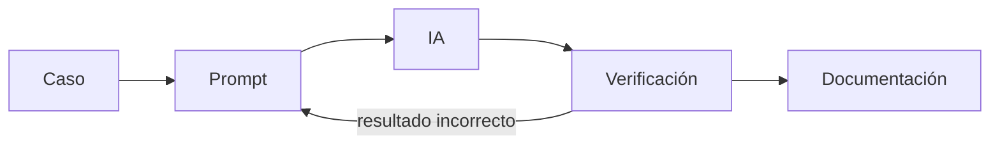
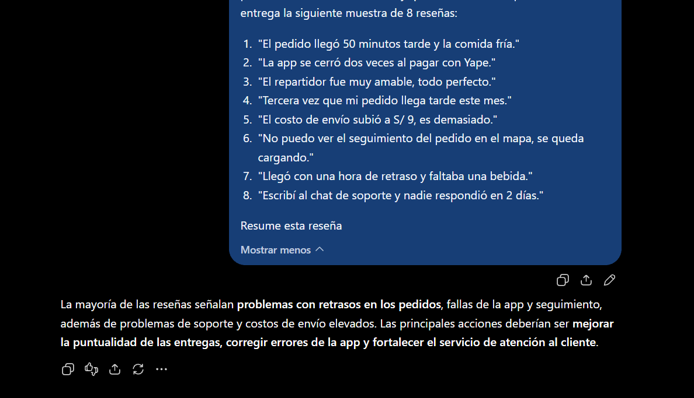
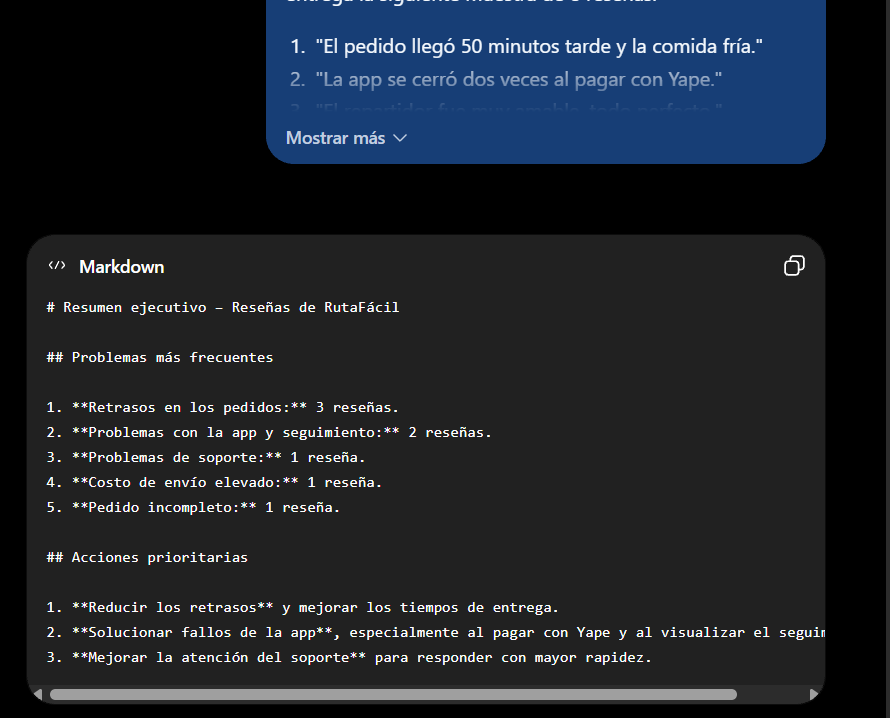
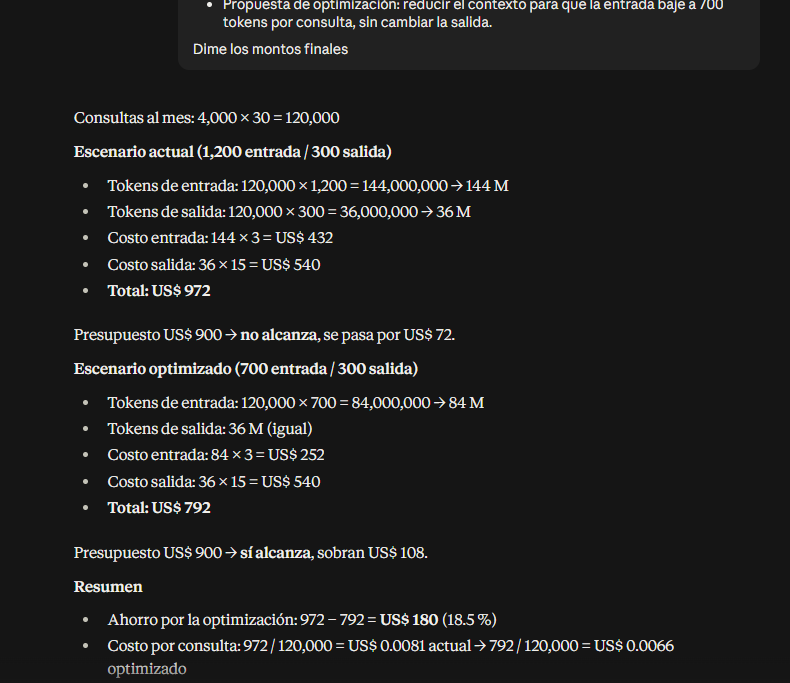
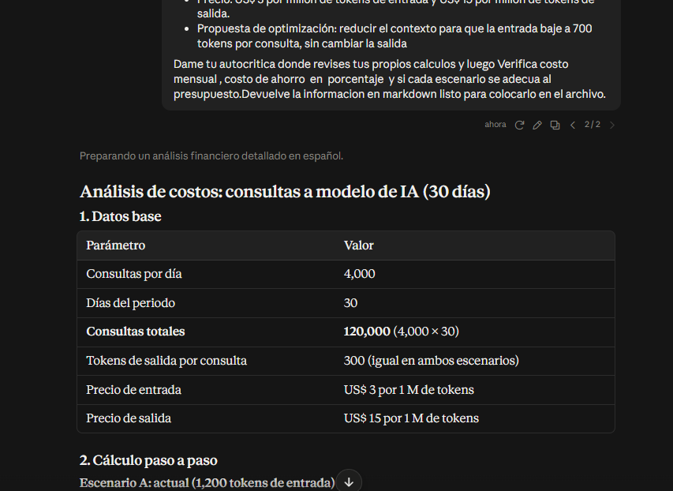
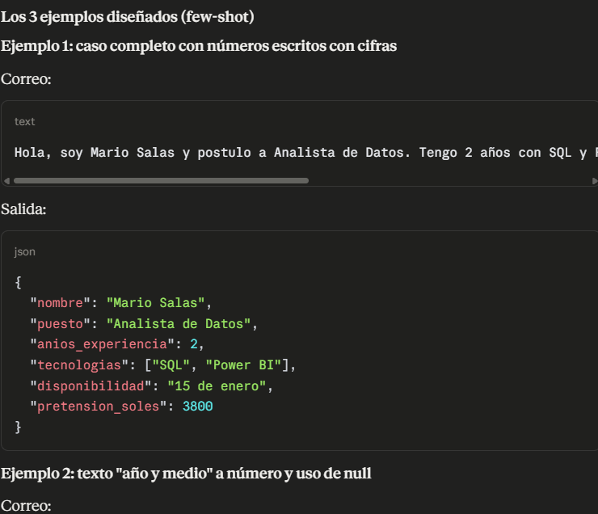

# Evaluación 02: Prompts, razonamiento y extracción con IA


Trabajo del curso **Diseño de Interfaces de Programación Avanzado** (DD-106), ciclo V.
Alumno: Villacorta Layza Juan Alejandro

Documenta tres casos resueltos con ChatGPT, Claude y Gemini, y una comparación final basada en pruebas propias.

## Tabla de contenidos

- [Flujo de trabajo](#flujo-de-trabajo)
- [Pregunta 1: ChatGPT](#pregunta-1-chatgpt)
- [Pregunta 2: Claude](#pregunta-2-claude)
- [Pregunta 3: IA libre](#pregunta-3-ia-libre)
- [Tabla comparativa](#tabla-comparativa)
- [Conclusión](#conclusión)
- [Checklist de entregables](#checklist-de-entregables)

## Flujo de trabajo



---

## Pregunta 1: ChatGPT

### Componentes del prompt

| Componente | Aplicado al caso RutaFácil |
| --- | --- |
| Rol | Analista de experiencia de cliente de una startup de delivery |
| Contexto | RutaFácil recibe cientos de reseñas por semana; el jefe de producto necesita saber qué problemas son más frecuentes y qué hacer primero; se entrega una muestra de 8 reseñas |
| Tarea | Clasificar las reseñas por categoría, contar cuántas hay en cada una y proponer 3 acciones prioritarias justificadas |
| Formato de salida | Tabla Markdown `Categoría \| Cantidad \| Ejemplo` y lista numerada de 3 acciones con su justificación |
| Restricciones | Usar solo las reseñas dadas, no inventar datos, contar en ambas categorías las reseñas con dos problemas, máximo 150 palabras |

### Prompt vago

```text
Resume estas reseñas:
1. "El pedido llegó 50 minutos tarde y la comida fría."
2. "La app se cerró dos veces al pagar con Yape."
3. "El repartidor fue muy amable, todo perfecto."
4. "Tercera vez que mi pedido llega tarde este mes."
5. "El costo de envío subió a S/ 9, es demasiado."
6. "No puedo ver el seguimiento del pedido en el mapa, se queda cargando."
7. "Llegó con una hora de retraso y faltaba una bebida."
8. "Escribí al chat de soporte y nadie respondió en 2 días."
```

Captura: 

### Prompt final

```text
Actúa como analista de experiencia de cliente de una startup de delivery.

Contexto: RutaFácil recibe cientos de reseñas por semana. El jefe de producto necesita un resumen ejecutivo que indique qué problemas son más frecuentes y qué acciones tomar primero. Esta es una muestra de 8 reseñas:
1. "El pedido llegó 50 minutos tarde y la comida fría."
2. "La app se cerró dos veces al pagar con Yape."
3. "El repartidor fue muy amable, todo perfecto."
4. "Tercera vez que mi pedido llega tarde este mes."
5. "El costo de envío subió a S/ 9, es demasiado."
6. "No puedo ver el seguimiento del pedido en el mapa, se queda cargando."
7. "Llegó con una hora de retraso y faltaba una bebida."
8. "Escribí al chat de soporte y nadie respondió en 2 días."

Tarea: clasifica las reseñas por categoría, cuenta cuántas reseñas hay en cada una y propone 3 acciones prioritarias justificadas.

Formato: una tabla Markdown con las columnas Categoría | Cantidad | Ejemplo, y debajo una lista numerada con las 3 acciones, cada una con su justificación en una línea.

Restricciones: usa solo la información de las reseñas, no inventes datos, si una reseña menciona dos problemas cuéntala en ambas categorías e indícalo, y no pases de 150 palabras.
```

Captura: 

### Verificación del conteo (manual)

| Categoría | Reseñas | Cantidad |
| --- | --- | --- |
| Retraso en la entrega | 1, 4, 7 | 3 |
| Fallas de la app | 2 (pago con Yape), 6 (seguimiento) | 2 |
| Pedido en mal estado o incompleto | 1 (comida fría), 7 (faltaba una bebida) | 2 |
| Costo de envío | 5 | 1 |
| Atención de soporte | 8 | 1 |
| Comentario positivo | 3 | 1 |

Hay 8 reseñas y 10 menciones, porque las reseñas 1 y 7 tienen dos problemas cada una y se cuentan en ambas categorías. Por eso la reseña 7 debe aparecer en "Retraso" y también en "Pedido incompleto".


### Métricas

| Dato | Valor |
| --- | --- |
| Modelo | 5 |
| Plan | Gratuito |
| N.° de prompts | 2 |
| Tokens de entrada (aprox. prompt final) | ~350 |
| Tokens de salida | 250 |

---

## Pregunta 2: Claude

### Análisis del caso

| Elemento | Detalle |
| --- | --- |
| Datos | 4,000 consultas por día, 30 días, 1,200 tokens de entrada, 300 de salida, US$ 3 por millón de entrada, US$ 15 por millón de salida, presupuesto US$ 900 |
| Qué calcular | Costo mensual actual, costo optimizado con 700 tokens de entrada, ahorro en porcentaje y si cada escenario cumple el presupuesto |
| Pasos | Consultas al mes, tokens de entrada y salida al mes, costo de cada uno, suma, ahorro y comparación con US$ 900 |

### Cálculo manual

Consultas al mes: 4,000 × 30 = 120,000

**Escenario actual**

- Tokens de entrada: 120,000 × 1,200 = 144,000,000 (144 millones)
- Costo de entrada: 144 × 3 = US$ 432
- Tokens de salida: 120,000 × 300 = 36,000,000 (36 millones)
- Costo de salida: 36 × 15 = US$ 540
- Costo mensual actual: 432 + 540 = **US$ 972**

**Escenario optimizado**

- Tokens de entrada: 120,000 × 700 = 84,000,000 (84 millones)
- Costo de entrada: 84 × 3 = US$ 252
- Costo de salida: US$ 540 (no cambia)
- Costo mensual optimizado: 252 + 540 = **US$ 792**

**Ahorro**

- Ahorro en dólares: 972 − 792 = US$ 180
- Ahorro en porcentaje: 180 / 972 × 100 = **18.52 %**

| Escenario | Costo mensual | Presupuesto | ¿Cumple? |
| --- | --- | --- | --- |
| Actual | US$ 972 | US$ 900 | No, se pasa por US$ 72 |
| Optimizado | US$ 792 | US$ 900 | Sí, sobran US$ 108 |

### Prompt directo

```text
EduTech lanzará un chatbot con 4,000 consultas por día durante 30 días. Cada consulta usa 1,200 tokens de entrada y 300 de salida. Precio: US$ 3 por millón de tokens de entrada y US$ 15 por millón de salida. Con una optimización la entrada baja a 700 tokens. Dame solo los montos finales (costo actual, costo optimizado y ahorro en porcentaje), sin explicación.
```

Captura: 

### Prompt final

```text
Actúa como analista financiero de TI.

<contexto>
EduTech lanzará un chatbot de atención a estudiantes que usa la API de un modelo de lenguaje. Finanzas aprobó un presupuesto de US$ 900 mensuales y pide verificar si alcanza.
</contexto>

<datos>
- Consultas: 4,000 por día durante 30 días
- Tokens de entrada por consulta: 1,200
- Tokens de salida por consulta: 300
- Precio: US$ 3 por millón de tokens de entrada y US$ 15 por millón de tokens de salida
- Optimización: bajar la entrada a 700 tokens por consulta, sin cambiar la salida
- Presupuesto mensual: US$ 900
</datos>

<tarea>
Calcula el costo mensual actual, el costo mensual optimizado, el ahorro en porcentaje y si cada escenario cumple el presupuesto.
</tarea>

<formato>
Escribe el razonamiento paso a paso dentro de <razonamiento> y la respuesta final dentro de <respuesta>, con una tabla de dos escenarios.
</formato>

Antes de responder, revisa tus propios cálculos paso a paso y corrige cualquier error que encuentres.
```

Captura: 

### Comparación con la respuesta de Claude

# Análisis de costos: consultas a modelo de IA (30 días)

## 1. Datos base

| Parámetro | Valor |
|---|---|
| Consultas por día | 4,000 |
| Días del periodo | 30 |
| **Consultas totales** | **120,000** (4,000 × 30) |
| Tokens de salida por consulta | 300 (igual en ambos escenarios) |
| Precio de entrada | US$ 3 por 1 M de tokens |
| Precio de salida | US$ 15 por 1 M de tokens |

## 2. Cálculo paso a paso

### Escenario A: actual (1,200 tokens de entrada)

- Entrada: 120,000 × 1,200 = 144,000,000 tokens = 144 M → 144 × 3 = **US$ 432**
- Salida: 120,000 × 300 = 36,000,000 tokens = 36 M → 36 × 15 = **US$ 540**
- **Total A = US$ 972 / mes**

### Escenario B: optimizado (700 tokens de entrada)

- Entrada: 120,000 × 700 = 84,000,000 tokens = 84 M → 84 × 3 = **US$ 252**
- Salida: igual que A = **US$ 540**
- **Total B = US$ 792 / mes**

## 3. Comparación

| Concepto | Escenario A | Escenario B | Diferencia |
|---|---|---|---|
| Costo de entrada | US$ 432.00 | US$ 252.00 | −US$ 180.00 |
| Costo de salida | US$ 540.00 | US$ 540.00 | US$ 0.00 |
| **Costo mensual total** | **US$ 972.00** | **US$ 792.00** | **−US$ 180.00** |
| Costo por consulta | US$ 0.0081 | US$ 0.0066 | −US$ 0.0015 |
| Costo diario | US$ 32.40 | US$ 26.40 | −US$ 6.00 |
| Costo anual (12 meses de 30 días) | US$ 11,664 | US$ 9,504 | −US$ 2,160 |

### Ahorro en porcentaje

- **Ahorro sobre el costo total:** 180 / 972 = **18.52 %**
- Ahorro solo sobre la entrada: 180 / 432 = 41.67 % (equivale a 1 − 700/1,200)

## 4. Verificación contra presupuesto

El enunciado **no indica el presupuesto**, así que no se puede dar un veredicto definitivo. La regla es:

- Escenario A cumple si presupuesto ≥ US$ 972
- Escenario B cumple si presupuesto ≥ US$ 792

| Presupuesto mensual | Escenario A (US$ 972) | Escenario B (US$ 792) |
|---|---|---|
| US$ 800 | ❌ Excede en US$ 172 | ✅ Cumple, margen de US$ 8 |
| US$ 900 | ❌ Excede en US$ 72 | ✅ Cumple, margen de US$ 108 |
| US$ 1,000 | ✅ Cumple, margen de US$ 28 | ✅ Cumple, margen de US$ 208 |

> **Pendiente:** reemplazar esta tabla con el presupuesto real del proyecto.

## 5. Autocrítica

**Lo que revisé y está bien:**

- La conversión de unidades es correcta: 144,000,000 tokens equivalen a 144 millones, no a 144,000.
- Verifiqué el resultado por dos caminos: por totales (972 − 792 = 180) y por consulta (0.0015 × 120,000 = 180). Coinciden.
- El 18.52 % es coherente: la entrada pesa 44.4 % del costo total (432/972), y 44.4 % × 41.67 % ≈ 18.52 %.

**Limitaciones y riesgos:**

1. **Falta el presupuesto.** Sin ese dato, la verificación es condicional.
2. **Supuesto de 30 días fijos.** Un mes de 31 días sube el costo (A ≈ US$ 1,004; B ≈ US$ 818), y el ahorro porcentual no cambia.
3. **La salida pesa más que la entrada.** Es 55.6 % del costo (540/972) y no se optimizó. Si el recorte de contexto cambiara el tamaño de las respuestas, el ahorro real sería distinto.
4. **Riesgo de calidad.** Bajar el contexto de 1,200 a 700 tokens (−41.7 %) puede reducir la precisión de las respuestas. Si eso genera más reintentos, parte del ahorro se pierde. Conviene medirlo con una prueba piloto.
5. **No se incluyen otros costos:** impuestos, picos de tráfico, descuentos por caché o lotes, ni infraestructura adicional.
6. **El costo anual es una extrapolación** de 12 meses de 30 días (360 días), no de un año calendario.

## 6. Conclusión

El Escenario B cuesta **US$ 792/mes** frente a **US$ 972/mes** del A. Eso es un **ahorro de US$ 180 (18.52 %)**, o **US$ 2,160 al año**. Recomiendo B siempre que la calidad de las respuestas se mantenga con el contexto reducido. Con el presupuesto real se puede cerrar la verificación de cumplimiento.

### Métricas

| Dato | Valor |
| --- | --- |
| Modelo | 5.0 |
| Plan | gratuito |
| N.° de prompts | 2 |
| Tokens de entrada (aprox. prompt final) | ~250 |
| Tokens de salida | 300 |

---

## Pregunta 3: IA libre

IA elegida: **claude**

### Esquema JSON

```json
{
  "nombre": "texto",
  "puesto": "texto",
  "anios_experiencia": 0,
  "tecnologias": ["texto"],
  "disponibilidad": "texto",
  "pretension_soles": 0
}
```

`pretension_soles` es número, o `null` cuando el correo no la menciona.

### Correos a procesar

```text
1. "Buenas tardes, me llamo Rosa Quispe y postulo al puesto de Desarrolladora Backend. Tengo 3 años trabajando con Python y Django, y algo de Docker. Puedo empezar el 1 de diciembre. Mi expectativa es S/ 4,500."
2. "Hola, soy Diego Ramírez. Me interesa la vacante de Frontend. Llevo año y medio con React y TypeScript. Disponibilidad inmediata."
3. "Estimados, adjunto mi CV para QA Automation. Mi nombre es Lucía Fernández; 5 años de experiencia con Selenium, Cypress y Java. Pretensión: 6000 soles. Podría incorporarme en dos semanas."
```

### Zero-shot

```text
Convierte los siguientes correos de postulación a JSON con los campos: nombre, puesto, anios_experiencia (número), tecnologias (lista), disponibilidad y pretension_soles (número o null). Devuelve solo el JSON.

1. "Buenas tardes, me llamo Rosa Quispe y postulo al puesto de Desarrolladora Backend. Tengo 3 años trabajando con Python y Django, y algo de Docker. Puedo empezar el 1 de diciembre. Mi expectativa es S/ 4,500."
2. "Hola, soy Diego Ramírez. Me interesa la vacante de Frontend. Llevo año y medio con React y TypeScript. Disponibilidad inmediata."
3. "Estimados, adjunto mi CV para QA Automation. Mi nombre es Lucía Fernández; 5 años de experiencia con Selenium, Cypress y Java. Pretensión: 6000 soles. Podría incorporarme en dos semanas."
```


### Los 3 ejemplos diseñados (few-shot)

**Ejemplo 1: caso completo con números en cifras**

Correo:

```text
Hola, soy Mario Salas y postulo a Analista de Datos. Tengo 2 años con SQL y Power BI. Estoy disponible desde el 15 de enero. Mi pretensión es S/ 3,800.
```

JSON:

```json
{
  "nombre": "Mario Salas",
  "puesto": "Analista de Datos",
  "anios_experiencia": 2,
  "tecnologias": ["SQL", "Power BI"],
  "disponibilidad": "15 de enero",
  "pretension_soles": 3800
}
```

**Ejemplo 2: "año y medio" a número y uso de null**

Correo:

```text
Saludos, soy Carla Mendoza y me interesa el puesto de DevOps. Llevo año y medio con AWS y Terraform. Puedo empezar de inmediato.
```

JSON:

```json
{
  "nombre": "Carla Mendoza",
  "puesto": "DevOps",
  "anios_experiencia": 1.5,
  "tecnologias": ["AWS", "Terraform"],
  "disponibilidad": "Inmediata",
  "pretension_soles": null
}
```

**Ejemplo 3: meses a años y pretensión escrita con palabras**

Correo:

```text
Buen día, soy Pedro Huamán y quiero postular a Soporte TI. Tengo seis meses de experiencia con Windows Server y Linux. Podría incorporarme en una semana. Pretensión: 2500 soles.
```

JSON:

```json
{
  "nombre": "Pedro Huamán",
  "puesto": "Soporte TI",
  "anios_experiencia": 0.5,
  "tecnologias": ["Windows Server", "Linux"],
  "disponibilidad": "En una semana",
  "pretension_soles": 2500
}
```

### Few-shot (conversación nueva)

```text
Convierte correos de postulación a JSON con el esquema indicado. Devuelve solo el JSON.

Esquema: nombre, puesto, anios_experiencia (número), tecnologias (lista), disponibilidad, pretension_soles (número o null).

Ejemplo 1
Correo: "Hola, soy Mario Salas y postulo a Analista de Datos. Tengo 2 años con SQL y Power BI. Estoy disponible desde el 15 de enero. Mi pretensión es S/ 3,800."
JSON: {"nombre": "Mario Salas", "puesto": "Analista de Datos", "anios_experiencia": 2, "tecnologias": ["SQL", "Power BI"], "disponibilidad": "15 de enero", "pretension_soles": 3800}

Ejemplo 2
Correo: "Saludos, soy Carla Mendoza y me interesa el puesto de DevOps. Llevo año y medio con AWS y Terraform. Puedo empezar de inmediato."
JSON: {"nombre": "Carla Mendoza", "puesto": "DevOps", "anios_experiencia": 1.5, "tecnologias": ["AWS", "Terraform"], "disponibilidad": "Inmediata", "pretension_soles": null}

Ejemplo 3
Correo: "Buen día, soy Pedro Huamán y quiero postular a Soporte TI. Tengo seis meses de experiencia con Windows Server y Linux. Podría incorporarme en una semana. Pretensión: 2500 soles."
JSON: {"nombre": "Pedro Huamán", "puesto": "Soporte TI", "anios_experiencia": 0.5, "tecnologias": ["Windows Server", "Linux"], "disponibilidad": "En una semana", "pretension_soles": 2500}

Ahora procesa estos correos:
1. "Buenas tardes, me llamo Rosa Quispe y postulo al puesto de Desarrolladora Backend. Tengo 3 años trabajando con Python y Django, y algo de Docker. Puedo empezar el 1 de diciembre. Mi expectativa es S/ 4,500."
2. "Hola, soy Diego Ramírez. Me interesa la vacante de Frontend. Llevo año y medio con React y TypeScript. Disponibilidad inmediata."
3. "Estimados, adjunto mi CV para QA Automation. Mi nombre es Lucía Fernández; 5 años de experiencia con Selenium, Cypress y Java. Pretensión: 6000 soles. Podría incorporarme en dos semanas."
```


### Resultado correcto esperado

```json
[
  {
    "nombre": "Rosa Quispe",
    "puesto": "Desarrolladora Backend",
    "anios_experiencia": 3,
    "tecnologias": ["Python", "Django", "Docker"],
    "disponibilidad": "1 de diciembre",
    "pretension_soles": 4500
  },
  {
    "nombre": "Diego Ramírez",
    "puesto": "Frontend",
    "anios_experiencia": 1.5,
    "tecnologias": ["React", "TypeScript"],
    "disponibilidad": "Inmediata",
    "pretension_soles": null
  },
  {
    "nombre": "Lucía Fernández",
    "puesto": "QA Automation",
    "anios_experiencia": 5,
    "tecnologias": ["Selenium", "Cypress", "Java"],
    "disponibilidad": "En dos semanas",
    "pretension_soles": 6000
  }
]
```

### Validación y diferencias

Las dos salidas se validaron en un validador JSON (jsonlint.com).

Capturas: 

| Pregunta | Zero-shot | Few-shot |
| --- | --- | --- |
| ¿El JSON es válido? | si | s |
| ¿Respetó los nombres de los campos? | si | si |
| ¿Convirtió bien los números ("año y medio" a 1.5, "6000 soles" a 6000)? | si | si |
| ¿Usó null cuando faltaba el dato (Diego)? | si | si |

### Métricas

| Dato | Valor |
| --- | --- |
| Modelo | 5 |
| Plan | gratuito |
| N.° de prompts | 2 |
| Tokens de entrada (aprox. few-shot) | ~700 |
| Tokens de salida | 800 |

---

## Tabla comparativa

| Criterio | ChatGPT | Claude | IA libre: Gemini |
| --- | :---: | :---: | :---: |
| Calidad de la respuesta (1-5) | 5 | 5 | 4 |
| Precisión (aciertos / total verificado) | 10 / 10 menciones | 3 / 3 montos | 3 / 3 correos |
| Precio del plan o de la API (US$) | Plus: 20 al mes | Pro: 20 al mes; API: 3 y 15 por millón de tokens | Plan gratuito: 0 |
| N.° de prompts hasta un resultado útil | 2| 2 | 2 |
| Tokens aproximados y costo estimado | ~350 de entrada, costo 0.10$  | ~250 de entrada, costo 0.10$ | ~700 de entrada, costo 0 en plan gratuito |

Fuentes de precios: [ChatGPT](https://openai.com/chatgpt/pricing), [Claude](https://claude.com/pricing) y [Gemini](https://gemini.google/subscriptions/). Los precios de esta tabla deben coincidir con lo que muestren esas páginas el día que entregues.

## Conclusión

La IA que mejor me sirvió fue claude (escribe cuál). En la pregunta 1, ChatGPT acertó 10 de 10 menciones y necesité 2 o 3 prompts hasta un resultado útil; el prompt vago solo me dio un resumen general, mientras que el prompt estructurado devolvió la tabla y las acciones que pedía el jefe de producto. En la pregunta 2, mi cálculo manual dio US$ 972 para el escenario actual y US$ 792 para el optimizado, un ahorro de 18.52 %, y Claude respondió muy bien con el prompt final, donde el razonamiento en XML y la autocrítica ayudaron a mejorar. En la pregunta 3, Gemini con few-shot produjo 3 de 3 JSON correctos, frente a 3 de 3 en zero-shot, sobre todo en el uso de null y en convertir "año y medio" a 1.5. Sobre el precio, ChatGPT Plus y Claude Pro cuestan US$ 20 al mes según sus páginas oficiales, y Gemini tiene un plan gratuito. Usaría ChatGPT para tareas de resumen y clasificación de texto, Claude para cálculos y razonamiento paso a paso, y Gemini para extracción de datos en formato JSON cuando importa el costo. En los tres casos verifiqué la salida a mano, porque la IA puede equivocarse en conteos y en cálculos.

## Checklist de entregables

- [x] P1: tabla de componentes
- [x] P1: prompt vago y prompt final
- [x] P1: capturas de ambas respuestas
- [x] P1: verificación del conteo
- [x] P1: métricas con los datos de mi prueba
- [x] P2: cálculo manual
- [x] P2: prompt directo y prompt final
- [x] P2: capturas y comparación con los resultados de Claude
- [x] P3: IA elegida y esquema JSON
- [x] P3: 3 ejemplos diseñados
- [x] P3: salidas zero-shot y few-shot validadas, con capturas
- [x] P3: tabla de diferencias y métricas
- [x] P4: tabla comparativa completa
- [x] P4: conclusión con mis resultados y fuentes de precios